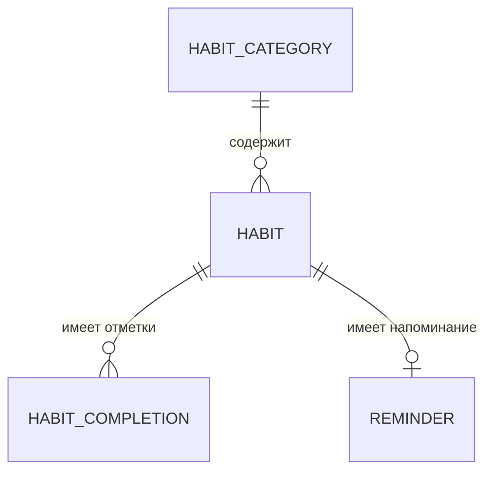

# Техническое задание LifeTrack

| Параметр | Значение |
|---|---|
| Название проекта | LifeTrack |
| Тип документа | Техническое задание (ТЗ) |
| Версия документа | 1.0 |
| Дата | 29.10.2026 |
| Статус | Утверждено к реализации |
| Пакет приложения | `com.example.lifetrack` |
| Целевая версия приложения | 1.0 (MVP) |
| Платформа | Android, minSdk 29 (Android 10), targetSdk 37, compileSdk 37 |

> Документ описывает целевую функциональность версии 1.0. Текущее состояние репозитория — стартовый шаблон Android-проекта (один экран `MainActivity` с приветственным текстом). Вся описанная ниже функциональность реализуется последовательно по плану из раздела 7. Подключение Room, Navigation Compose, DataStore и WorkManager выполняется на итерации 2.

---

## Содержание

1. [Общая информация](#1-общая-информация)
2. [Роли пользователей](#2-роли-пользователей)
3. [Основные сущности](#3-основные-сущности)
4. [Функциональные требования](#4-функциональные-требования)
5. [Нефункциональные требования](#5-нефункциональные-требования)
6. [Основные экраны](#6-основные-экраны)
7. [План разработки](#7-план-разработки)
8. [Критерии готовности проекта](#8-критерии-готовности-проекта)
9. [Приложения](#9-приложения)

---

## 1. Общая информация

### 1.1. Название проекта

**LifeTrack** — учебное Android-приложение для отслеживания привычек.

### 1.2. Назначение приложения

LifeTrack помогает пользователю формировать и поддерживать полезные привычки без подключения к интернету. Приложение позволяет создавать привычки с индивидуальным расписанием, ежедневно отмечать их выполнение, наблюдать прогресс в календаре и статистике, получать локальные напоминания и открывать достижения за регулярность.

Ключевой принцип: **все данные принадлежат пользователю и хранятся только на его устройстве**.

### 1.3. Цель разработки

1. Создать законченное, самостоятельно используемое приложение для контроля привычек.
2. Отработать на практике полный цикл разработки Android-приложения: анализ требований, проектирование данных, архитектура MVVM, реализация интерфейса на Jetpack Compose, локальное хранение, фоновые задачи, тестирование и подготовка к сдаче.
3. Обеспечить простой и предсказуемый пользовательский опыт: минимум действий для ежедневной отметки, наглядная обратная связь, отсутствие перегруженных настроек.

### 1.4. Целевая аудитория

| Сегмент | Описание потребности |
|---|---|
| Пользователи, формирующие привычки | Хотят видеть список дел на сегодня, отмечать выполнение и следить за серией |
| Пользователи, которые не доверяют облачным сервисам | Нужно приложение, работающее полностью офлайн, без аккаунта и передачи данных |
| Студенты и начинающие разработчики | Используют проект как учебный пример архитектуры MVVM, Room, Compose, WorkManager |

Ограничения аудитории: возраст 16+, наличие устройства на Android 10 и выше, базовые навыки работы со смартфоном.

### 1.5. Основные возможности

- Создание, редактирование, деактивация и удаление привычек.
- Просмотр всех привычек, включая приостановленные, с открытием подробного экрана и повторной активацией.
- Выбор категории, иконки и цвета привычки.
- Гибкая периодичность: ежедневно, по дням недели, с интервалом в N дней.
- Ежедневная отметка выполнения в один тап.
- История выполнения и календарь активности по месяцам.
- Расчёт текущей и максимальной серии выполнения.
- Статистика за неделю, месяц и всё время, диаграммы активности.
- Локальные напоминания (WorkManager + системные уведомления).
- Светлая и тёмная темы, включая следование системной теме.
- Система достижений с автоматической разблокировкой.
- Приветственный экран при первом запуске.

### 1.6. Используемые технологии

| Технология | Назначение в проекте |
|---|---|
| Kotlin 2.2.10 | Язык разработки |
| Android Studio, AGP 9.4.1 | Среда и система сборки |
| Jetpack Compose (BOM 2026.02.01) | Декларативный интерфейс |
| Material 3 | Компоненты и стилистика интерфейса |
| MVVM | Архитектурный паттерн: UI ← ViewModel ← Repository ← Data Source |
| Room | Локальная реляционная база данных |
| Navigation Compose | Навигация между экранами |
| Kotlin Coroutines + Flow | Асинхронность и реактивные потоки данных |
| DataStore (Preferences) | Хранение пользовательских настроек |
| WorkManager | Планирование локальных напоминаний |
| JUnit 4, Compose UI Test | Модульное и UI-тестирование |

Дополнительные архитектурные решения:

- **Ручное внедрение зависимостей** через контейнер приложения (`AppContainer` в классе `Application`) и фабрики ViewModel. DI-библиотеки (Hilt, Koin) в проекте не используются.
- **Без сторонних библиотек графиков**: диаграммы рисуются средствами Compose (`Canvas`, `Box`, `LazyRow`).
- **Без сетевых библиотек**: приложение не содержит сетевого слоя и не запрашивает разрешение `INTERNET`.

Состав зависимостей на старте проекта (Compose, Material 3, Activity Compose, Lifecycle) расширяется на итерации 2 библиотеками Room (+ KSP), Navigation Compose, DataStore и WorkManager. Изменение Gradle-файлов выполняется только в рамках соответствующей итерации.

### 1.7. Что не входит в объём проекта

Явно **не реализуется**:

- серверная часть, облачное хранилище, синхронизация между устройствами;
- регистрация, авторизация, профиль пользователя;
- Firebase и любые внешние сервисы;
- искусственный интеллект, рекомендации, генерация привычек;
- социальные функции (друзья, рейтинги, публичные профили);
- платные подписки, реклама, аналитика поведения;
- экспорт/импорт файлов и резервное копирование внутри приложения (системное резервное копирование Android не является функцией приложения).

### 1.8. Термины и сокращения

| Термин | Определение |
|---|---|
| Привычка (Habit) | Пользовательская задача, которую нужно регулярно выполнять по расписанию |
| Запланированный день | Дата, в которую привычка должна быть выполнена согласно её периодичности |
| Отметка (Completion) | Запись о выполнении или осознанном пропуске привычки за конкретную дату |
| Серия (Streak) | Количество подряд идущих запланированных дней с выполнением |
| Активная привычка | Привычка, которая отображается на сегодня и участвует в напоминаниях |
| Приостановленная привычка | Привычка с `isActive = false`: отсутствует в режиме «Сегодня», не участвует в напоминаниях и общей статистике, но остаётся доступной в режиме «Все привычки» |
| Достижение (Achievement) | Награда, которая открывается автоматически при выполнении условия |
| MVP | Минимально достаточная версия продукта (версия 1.0) |

---

## 2. Роли пользователей

### 2.1. Единственная роль — пользователь

В приложении предусмотрена **одна роль — «Пользователь»**. Регистрация, вход, восстановление пароля, гостевой режим и разграничение прав доступа отсутствуют.

Пользователь получает полный доступ к функциональности приложения на своём устройстве сразу после установки.

### 2.2. Владение данными

- Все данные хранятся локально: привычки, категории, отметки, достижения и напоминания — в базе Room; настройки — в DataStore.
- Данные не передаются по сети и не покидают устройство средствами приложения.
- При удалении приложения его локальные данные удаляются системой. Восстановление после переустановки возможно только средствами системного резервного копирования Android (если оно включено на устройстве и поддерживается производителем); приложение не управляет этим процессом и не гарантирует восстановление.
- Несколько пользователей на одном устройстве не поддерживаются: данные общие для всех, кто имеет доступ к устройству.

### 2.3. Основные действия пользователя

| Действие | Результат |
|---|---|
| Пройти приветственный экран | Открывается главный экран, приложение готово к работе |
| Создать привычку | Привычка появляется в списке на сегодня согласно расписанию |
| Отредактировать привычку | Изменяются название, описание, категория, иконка, цвет, периодичность, напоминание |
| Деактивировать привычку | Привычка скрывается из списка на сегодня, напоминания отключаются, история сохраняется; привычка остаётся в режиме «Все привычки» |
| Активировать привычку снова | Привычка возвращается в расписание, напоминание перепланируется |
| Просмотреть все привычки | Открывается режим «Все привычки» главного экрана со списком активных и приостановленных привычек |
| Удалить привычку | Привычка, её отметки и напоминание удаляются безвозвратно после подтверждения |
| Отметить выполнение | Создаётся отметка за сегодня, пересчитываются серия и статистика |
| Снять отметку | Отметка за сегодня удаляется, серия и статистика пересчитываются |
| Отметить пропуск | Создаётся отметка со статусом «пропущено», серия прерывается |
| Открыть календарь | Просмотр активности по дням месяца |
| Открыть статистику | Просмотр прогресса за неделю, месяц, всё время |
| Открыть достижения | Просмотр полученных и закрытых достижений с прогрессом |
| Настроить тему и напоминания | Изменение оформления и глобальное управление уведомлениями |

### 2.4. Ограничения доступа и работы

1. **Нет авторизации** — доступ к данным определяется только доступом к разблокированному устройству.
2. **Нет синхронизации** — данные не переносятся между устройствами. После повторной установки состояние восстанавливается только системным резервным копированием Android, если оно включено; приложение не содержит собственного резервного копирования.
3. **Одна копия данных** — приложение не хранит резервных копий внутри себя.
4. **Отметки только за текущую дату** — в календаре и истории прошедшие дни доступны только для просмотра; изменить историю нельзя.
5. **Напоминания зависят от разрешений ОС** — без разрешения на уведомления (Android 13+) доставка не выполняется, а при агрессивной экономии батареи фактическое время может заметно отличаться от выбранного. Точное время доставки не гарантируется.
6. **Работа без интернета** — все функции доступны офлайн; сетевые разрешения не запрашиваются.

### 2.5. Основные пользовательские сценарии

**Сценарий A. Первый запуск.** Пользователь устанавливает приложение → видит приветственный экран из трёх шагов → нажимает «Начать» → попадает на пустой главный экран с подсказкой «Создайте первую привычку» → создаёт привычку «Пить воду», ежедневно, 08:00, напоминание включено → привычка появляется в списке на сегодня.

**Сценарий B. Ежедневное использование.** Пользователь открывает приложение утром → на главном экране видит привычки на сегодня и прогресс «0 из 3» → выполняет привычку и нажимает на круг-индикатор → отметка сохраняется, прогресс обновляется, появляется сообщение о серии → при достижении 7 дней подряд открывается достижение.

**Сценарий C. Анализ прогресса.** Пользователь открывает «Статистику» → переключает период «Месяц» → видит процент выполнения, количество отметок, диаграмму активности и лучшую привычку → переходит в статистику отдельной привычки и видит календарь-тепловую карту за 30 дней.

**Сценарий D. Работа с напоминанием.** Пользователь включает напоминание для привычки → система запрашивает разрешение на уведомления → пользователь разрешает → WorkManager планирует ближайший запуск → в указанное время приходит уведомление → нажатие открывает подробный экран привычки.

---

## 3. Основные сущности

### 3.1. Общие правила хранения

| Правило | Описание |
|---|---|
| Идентификаторы | `Long`, первичный ключ, автогенерация (`autoGenerate = true`) |
| Даты без времени | Хранятся как `Long` — количество дней от 1970-01-01 (`LocalDate.toEpochDay()`), конвертация через TypeConverter |
| Моменты времени | Хранятся как `Long` — epoch millis (UTC) |
| Время напоминания | Хранится как `Int` — количество минут от начала суток (0…1439) |
| Цвет | Хранится как `Int` — ARGB-значение |
| Перечисления | Хранятся как `String` (имя константы), конвертация через TypeConverter |
| Иконки | Хранятся как `String` — стабильный ключ иконки (например, `water`, `sport`), который маппится на векторный ресурс в UI. Числовые `resourceId` в базе не хранятся |
| Логическое удаление | Не используется: удаление привычки физическое, с каскадным удалением связанных записей |

### 3.2. Схема связей



Пояснение:

- `HabitCategory` 1 : N `Habit` — одна категория может содержать много привычек; у каждой привычки одна категория (или «Без категории»).
- `Habit` 1 : N `HabitCompletion` — одна привычка имеет много отметок; каждая отметка принадлежит одной привычке. Пара `(habit_id, date)` уникальна.
- `Habit` 1 : 1 `Reminder` — на привычку настраивается не более одного напоминания; напоминание принадлежит ровно одной привычке.
- `Achievement` не имеет внешних ключей: достижения — глобальные записи приложения, их условия вычисляются по данным всех привычек.

### 3.3. Habit — привычка

| Поле | Тип Kotlin | Тип в Room | Обязательное | Описание и ограничения |
|---|---|---|---|---|
| `id` | `Long` | INTEGER, PK | Да | Первичный ключ, автогенерация |
| `name` | `String` | TEXT | Да | Название. 1…60 символов, не пустое после `trim()` |
| `description` | `String?` | TEXT, NULL | Нет | Описание. До 255 символов. Пустая строка нормализуется в `null` |
| `categoryId` | `Long?` | INTEGER, FK → `habit_categories.id` | Нет | Категория. `null` отображается как «Без категории». `ON DELETE SET NULL` |
| `icon` | `String` | TEXT | Да | Ключ иконки из встроенного набора. По умолчанию `star` |
| `color` | `Int` | INTEGER | Да | ARGB-цвет. По умолчанию — цвет выбранной категории |
| `createdAt` | `Long` | INTEGER | Да | Момент создания, epoch millis. Устанавливается приложением |
| `frequencyType` | `FrequencyType` | TEXT | Да | Тип периодичности: `DAILY`, `WEEKLY`, `INTERVAL` |
| `weekDaysMask` | `Int?` | INTEGER, NULL | Условно | Битовая маска дней недели для `WEEKLY`: бит 0 — понедельник, бит 6 — воскресенье; значение 1…127. Обязательно при `WEEKLY`, иначе `null` |
| `intervalDays` | `Int?` | INTEGER, NULL | Условно | Интервал в днях для `INTERVAL`: 2…30. Обязательно при `INTERVAL`, иначе `null` |
| `isActive` | `Boolean` | INTEGER (0/1) | Да | Статус активности. По умолчанию `true` |

Индексы и ограничения:

- индекс по `isActive` (фильтрация списков «Сегодня» и «Все привычки»);
- индекс по `categoryId` (выбор и группировка по категориям);
- валидация на уровне приложения: `name` не пустое, `intervalDays` в диапазоне, `weekDaysMask` содержит хотя бы один день;
- производные значения (текущая серия, максимальная серия, процент выполнения, ближайшая запланированная дата) **не хранятся** и вычисляются по запросу.

Правила периодичности:

1. `DAILY` — каждый календарный день, начиная с даты создания (`createdAt`).
2. `WEEKLY` — только дни, отмеченные в `weekDaysMask`.
3. `INTERVAL` — каждый N-й день от даты создания: `createdAt + k × N`, где `k ≥ 0`.
4. Все вычисления выполняются по локальной дате устройства; время суток на расписание не влияет (кроме напоминаний).
5. Привычка не может быть запланирована на дату раньше даты своего создания.

### 3.4. HabitCategory — категория

| Поле | Тип Kotlin | Тип в Room | Обязательное | Описание и ограничения |
|---|---|---|---|---|
| `id` | `Long` | INTEGER, PK | Да | Первичный ключ. Для предустановленных категорий значения фиксированы |
| `name` | `String` | TEXT, UNIQUE | Да | Название. 1…40 символов, уникальное |
| `icon` | `String` | TEXT | Да | Ключ иконки из встроенного набора |
| `color` | `Int` | INTEGER | Да | ARGB-цвет категории, используется как цвет по умолчанию при создании привычки |

Особенности:

- Категории — **справочные данные**. Пользователь выбирает категорию, но не создаёт, не переименовывает и не удаляет их (управление категориями не входит в объём MVP).
- Предустановленный набор (заполняется при первом создании базы, идемпотентно): «Здоровье», «Спорт», «Обучение», «Работа», «Дом», «Отдых».
- Если ни одна категория не выбрана, привычка отображается в группе «Без категории»; такая группа не является записью в таблице.

### 3.5. HabitCompletion — выполнение привычки

| Поле | Тип Kotlin | Тип в Room | Обязательное | Описание и ограничения |
|---|---|---|---|---|
| `id` | `Long` | INTEGER, PK | Да | Первичный ключ, автогенерация |
| `habitId` | `Long` | INTEGER, FK → `habits.id`, INDEX | Да | Привычка, к которой относится отметка. `ON DELETE CASCADE` |
| `date` | `Long` | INTEGER (epochDay) | Да | Дата, за которую поставлена отметка. Не может быть позже текущей даты |
| `status` | `CompletionStatus` | TEXT | Да | Статус: `DONE` — выполнено, `SKIPPED` — пропущено |

Индексы и ограничения:

- уникальный составной индекс `(habitId, date)` — одна отметка на привычку в день;
- индекс по `date` — выборки для календаря и статистики;
- вставка выполняется в режиме `INSERT OR REPLACE` (повторная отметка обновляет статус, а не создаёт дубликат).

Семантика статусов:

- `DONE` — привычка выполнена; участвует в серии и в числителе процента выполнения.
- `SKIPPED` — пользователь осознанно отметил пропуск; прерывает текущую серию, отображается в истории и календаре отдельным цветом, в числитель выполненных не входит.
- Отсутствие записи за запланированный день трактуется как невыполнение и также прерывает серию.

### 3.6. Achievement — достижение

| Поле | Тип Kotlin | Тип в Room | Обязательное | Описание и ограничения |
|---|---|---|---|---|
| `id` | `Long` | INTEGER, PK | Да | Первичный ключ, автогенерация |
| `code` | `String` | TEXT, UNIQUE | Да | Стабильный код условия (например, `STREAK_7`). Используется логикой разблокировки, не отображается пользователю |
| `name` | `String` | TEXT | Да | Название достижения. До 60 символов |
| `description` | `String` | TEXT | Да | Описание условия. До 200 символов |
| `icon` | `String` | TEXT | Да | Ключ иконки из встроенного набора |
| `conditionType` | `AchievementConditionType` | TEXT | Да | Тип условия (см. таблицу ниже) |
| `targetValue` | `Int` | INTEGER | Да | Целевое значение условия; для условий-флагов равно `1` |
| `isUnlocked` | `Boolean` | INTEGER (0/1) | Да | Статус разблокировки. По умолчанию `false` |
| `unlockedAt` | `Long?` | INTEGER, NULL | Нет | Дата и время получения, epoch millis. `null`, пока достижение не открыто |

Типы условий:

| `conditionType` | Условие | `targetValue` |
|---|---|---|
| `FIRST_HABIT_CREATED` | Создана хотя бы одна привычка (проверяется при создании) | 1 |
| `TOTAL_COMPLETIONS` | Суммарное число отметок `DONE` | 1 / 10 / 50 / 100 |
| `CURRENT_STREAK_DAYS` | Текущая серия любой привычки достигла N дней | 7 / 30 |
| `ACTIVE_HABITS_COUNT` | Количество активных привычек не меньше N | 5 |
| `CATEGORIES_USED` | Привычки созданы в N разных категориях | 3 |
| `PERFECT_WEEK` | Все запланированные привычки выполнены за календарную неделю (пн–вс) без пропусков | 1 |

Начальный набор достижений (заполняется при первом создании базы):

| Код | Название | Условие |
|---|---|---|
| `FIRST_HABIT` | Первый шаг | Создана первая привычка |
| `FIRST_COMPLETION` | Есть результат | Первое выполнение |
| `COMPLETIONS_10` | Разгон | 10 выполнений |
| `COMPLETIONS_50` | В ритме | 50 выполнений |
| `COMPLETIONS_100` | Сотня | 100 выполнений |
| `STREAK_7` | Неделя силы | Текущая серия 7 дней |
| `STREAK_30` | Месяц дисциплины | Текущая серия 30 дней |
| `HABITS_5` | Коллекционер | 5 активных привычек |
| `CATEGORIES_3` | Разносторонний | Привычки в 3 категориях |
| `PERFECT_WEEK` | Идеальная неделя | 100 % выполнения за неделю |

Правила:

- Достижения не удаляются и не отзываются: после `isUnlocked = true` статус не меняется, даже если привычка удалена.
- Повторная проверка идемпотентна: уже открытое достижение не обновляет `unlockedAt`.
- В списке отображается прогресс для измеримых условий (например, «7 / 30»).

### 3.7. Reminder — напоминание

| Поле | Тип Kotlin | Тип в Room | Обязательное | Описание и ограничения |
|---|---|---|---|---|
| `id` | `Long` | INTEGER, PK | Да | Первичный ключ, автогенерация |
| `habitId` | `Long` | INTEGER, FK → `habits.id`, UNIQUE | Да | Привычка. `ON DELETE CASCADE`. Одно напоминание на привычку |
| `timeMinutes` | `Int` | INTEGER | Да | Время уведомления в минутах от начала суток: 0…1439 (например, 08:00 → 480) |
| `isActive` | `Boolean` | INTEGER (0/1) | Да | Статус активности напоминания |

Технические правила:

- Уникальный идентификатор работы WorkManager формируется как `habit_reminder_<habitId>`; при удалении или отключении напоминания работа отменяется.
- Напоминание срабатывает только в запланированный день привычки: для `WEEKLY` — в выбранные дни недели, для `INTERVAL` — в дни, кратные интервалу.
- Если время уже прошло, планируется ближайший будущий запланированный день.
- Напоминания для неактивной привычки не планируются.
- Глобальное отключение напоминаний в настройках отменяет все работы, не удаляя записи `Reminder`; при повторном включении работы перепланируются.

### 3.8. Связи между сущностями и правила целостности

| Связь | Кардинальность | Внешний ключ | Поведение при удалении родителя | Поведение при обновлении |
|---|---|---|---|---|
| Категория → привычки | 1 : N | `habits.category_id` | `SET NULL` | `CASCADE` |
| Привычка → отметки | 1 : N | `habit_completions.habit_id` | `CASCADE` | `CASCADE` |
| Привычка → напоминание | 1 : 1 | `reminders.habit_id` | `CASCADE` | `CASCADE` |
| Достижения | Независимая таблица | — | — | — |

Дополнительные правила:

1. Удаление привычки в одной транзакции удаляет её отметки и напоминание, после чего отменяется работа WorkManager. Достижения, полученные ранее, остаются открытыми.
2. Удаление категории пользователем невозможно; правило `SET NULL` описано как защита на случай изменения справочника в будущих версиях.
3. `HabitCompletion.date` не может быть в будущем: проверка выполняется на уровне репозитория.
4. Отметка может быть создана только для запланированного дня привычки; для незапланированного дня UI не показывает действие отметки.
5. Настройки приложения (DataStore) не входят в реляционную схему и не связаны внешними ключами с сущностями.

### 3.9. Жизненный цикл привычки

1. **Создание** — пользователь заполняет форму, привычка сохраняется с `isActive = true`, рассчитывается ближайшая запланированная дата, при необходимости создаётся `Reminder` и планируется работа.
2. **Активное использование** — привычка появляется в списке на сегодня в запланированные дни; пользователь ставит отметки.
3. **Деактивация** — `isActive = false`; привычка исчезает из списка «Сегодня», напоминания отменяются; история и максимальная серия сохраняются. Привычка остаётся видимой в режиме «Все привычки» и доступна для повторной активации.
4. **Повторная активация** — `isActive = true`; привычка снова попадает в расписание с текущей даты; напоминание перепланируется.
5. **Удаление** — после подтверждения привычка и связанные данные удаляются безвозвратно.

Правила учёта приостановки в MVP (история периодов активности не хранится):

1. Неактивные привычки не учитываются в общей статистике и не создают ожидаемых выполнений.
2. После повторной активации привычка снова учитывается в расписании с текущей даты.
3. История отметок сохраняется полностью и доступна в календаре и на подробном экране.
4. Отдельная история периодов приостановки не ведётся: хранится только текущее значение `isActive`.
5. Исторические показатели пересчитываются по текущему расписанию и текущему состоянию активности.

---

## 4. Функциональные требования

Требования сгруппированы по функциям и имеют идентификаторы `FR-<раздел>.<номер>`. Для каждой группы приведены критерии приёмки.

### 4.1. Создание, редактирование и удаление привычек

**FR-4.1.1. Создание привычки.** Пользователь создаёт привычку с главного экрана (FAB «+») или из пустого состояния. Форма содержит: название, описание, категорию, иконку, цвет, периодичность, напоминание.

**FR-4.1.2. Валидация формы.**

| Поле | Правило | Сообщение |
|---|---|---|
| Название | Обязательно, после `trim()` 1…60 символов | «Введите название привычки» / «Не более 60 символов» |
| Описание | Необязательно, до 255 символов | «Не более 255 символов» |
| Категория | Необязательно | — |
| Иконка | Обязательно выбрана (по умолчанию есть) | — |
| Цвет | Обязательно выбран (по умолчанию есть) | — |
| Периодичность | Выбран один из трёх типов; для `WEEKLY` — минимум один день; для `INTERVAL` — 2…30 | «Выберите хотя бы один день» / «Интервал от 2 до 30 дней» |
| Время напоминания | Если напоминание включено — корректное время 00:00…23:59 | — |

Кнопка «Сохранить» блокируется, пока форма невалидна или идёт сохранение. Ошибки показываются под соответствующим полем после попытки сохранения или потери фокуса.

**FR-4.1.3. Редактирование.** Форма редактирования открывается из подробного экрана привычки и из контекстного меню карточки. Поля предзаполнены текущими значениями. Сохранение обновляет запись и пересчитывает расписание/напоминание. Изменение периодичности **не удаляет существующие отметки**: они остаются в истории без изменений, а ожидаемые выполнения и проценты за прошедшие периоды пересчитываются по новому расписанию. Отдельная история изменения расписания не ведётся. Перед сохранением показывается предупреждение: «Изменение периодичности влияет на расчёт статистики за прошлые периоды».

**FR-4.1.4. Деактивация и активация.** Переключатель «Привычка активна» на подробном экране. При деактивации: привычка скрывается из списка на сегодня, напоминание отключается, открывается Snackbar «Привычка приостановлена»; привычка остаётся в режиме «Все привычки» с меткой «Приостановлена». При активации — возвращается в расписание и напоминание.

**FR-4.1.5. Удаление.** Доступно из подробного экрана и контекстного меню. Обязательный диалог подтверждения: «Удалить привычку? Вся история выполнения будет удалена без возможности восстановления». Кнопки «Удалить» (danger) и «Отмена». После удаления — возврат на предыдущий экран и Snackbar «Привычка удалена».

**FR-4.1.6. Критерии приёмки:**
- созданная привычка сразу появляется в списке на сегодня, если сегодня запланированный день и она активна;
- приостановленная привычка отсутствует в режиме «Сегодня», присутствует в режиме «Все привычки» и открывается на подробный экран;
- после перезапуска приложения привычка и все её поля сохраняются;
- отмена редактирования не изменяет данные;
- удаление привычки удаляет её отметки (проверяется в календаре и статистике);
- форма не позволяет сохранить пустое название.

### 4.2. Выбор категории, цвета и иконки

**FR-4.2.1. Категория.** В форме создания/редактирования категория выбирается из горизонтального списка чипов (плюс «Без категории»). Список загружается из Room. Выбор категории подставляет её цвет по умолчанию, если пользователь ещё не менял цвет вручную.

**FR-4.2.2. Цвет.** Пользователю доступна фиксированная палитра из 12 цветов, согласованных со светлой и тёмной темой. Выбранный цвет отображается:
- в круге-индикаторе привычки в списке на сегодня;
- в карточке привычки и на подробном экране;
- в отметках календаря.

**FR-4.2.3. Иконка.** Пользователю доступен встроенный набор из 20–24 иконок (вода, спорт, чтение, сон, питание, работа, дом, медитация и т. п.). Иконка отображается внутри цветного круга. Набор не требует внешних библиотек: иконки — векторные `drawable` или стандартные `Icons` из подключённого пакета Compose.

**FR-4.2.4. Критерии приёмки:**
- выбранные категория, цвет и иконка сохраняются и восстанавливаются после перезапуска;
- при смене темы сохранённый цвет привычки не меняется (адаптируется только насыщенность заливки и цвет текста/иконки);
- недоступных (несуществующих) ключей иконок в базе не возникает: неизвестный ключ заменяется на `star`.

### 4.3. Настройка периодичности выполнения

**FR-4.3.1. Типы периодичности.** Пользователь выбирает один из трёх вариантов:

| Тип | Интерфейс | Правило расписания |
|---|---|---|
| Ежедневно | Переключатель типа | Каждый день с даты создания |
| По дням недели | Семь переключателей Пн…Вс, по умолчанию — все дни | Только выбранные дни |
| С интервалом | Числовое поле/слайдер 2…30 дней | Каждый N-й день от даты создания |

**FR-4.3.2. Поведение формы.** При переключении типа показываются только относящиеся к нему поля; неиспользуемые значения очищаются (`weekDaysMask = null` для не-`WEEKLY`, `intervalDays = null` для не-`INTERVAL`). Выбор типа не сбрасывает остальные поля формы.

**FR-4.3.3. Отображение в интерфейсе.** На карточке привычки периодичность показывается текстом: «Каждый день», «Пн, Ср, Пт», «Каждые 3 дня».

**FR-4.3.4. Критерии приёмки:**
- привычка с периодичностью «Пн, Ср, Пт» не появляется в списке на сегодня во вторник;
- привычка с интервалом 3 дня, созданная в понедельник, появляется в понедельник, четверг, воскресенье и т. д.;
- невозможно сохранить `WEEKLY` без выбранных дней и `INTERVAL` со значением вне 2…30.

### 4.4. Ежедневное отмечание выполнения

**FR-4.4.1. Список на сегодня.** В режиме «Сегодня» (FR-4.4.7) главный экран показывает только активные привычки, запланированные на текущую дату, сгруппированные по категориям. Привычки с отметкой `DONE` визуально отличаются (заполненный круг, зачёркнутое/приглушённое название) и по умолчанию остаются на месте (порядок не меняется).

**FR-4.4.2. Отметка в один тап.** Нажатие на круг-индикатор:
- если отметки нет → создаётся `DONE`;
- если стоит `DONE` → отметка удаляется (снятие выполнения);
- если стоит `SKIPPED` → создаётся/заменяется на `DONE`.

Изменение сохраняется немедленно, без кнопки «Сохранить», и оптимистично отображается в UI; при ошибке записи состояние откатывается и показывается Snackbar.

**FR-4.4.3. Отметка пропуска.** Доступна через долгое нажатие на карточку или меню «…» → «Отметить пропуск». Создаётся `SKIPPED`; повторный выбор «Выполнено» заменяет статус.

**FR-4.4.4. Ограничения.** Отметка доступна только за текущую дату и только для активной привычки в запланированный день. После полуночи список пересобирается: вчерашние невыполненные дни остаются без отметок и учитываются как пропущенные.

**FR-4.4.5. Прогресс дня.** В режиме «Сегодня» в верхней части главного экрана отображается «Выполнено X из Y» и линейный индикатор. При `Y = 0` показывается текст «На сегодня привычек нет». В режиме «Все привычки» прогресс дня не показывается (FR-4.4.7).

**FR-4.4.6. Критерии приёмки:**
- одно нажатие меняет состояние и сохраняется в базе;
- повторное открытие приложения сохраняет отметки;
- при отсутствии запланированных привычек экран не пустой, а содержит понятное пустое состояние;
- изменение отметки сразу отражается в серии и статистике.

**FR-4.4.7. Режимы главного экрана («Сегодня» и «Все привычки»).** В верхней части главного экрана расположен переключатель из двух режимов; по умолчанию активен режим «Сегодня». Переключение режима не меняет маршрут и не перезагружает экран.

| Режим | Состав списка | Отметки | Блок прогресса дня |
|---|---|---|---|
| «Сегодня» | Только активные привычки, запланированные на текущую дату | Доступны | Показывается |
| «Все привычки» | Все созданные привычки: активные и приостановленные, независимо от расписания | Недоступны | Заменяется строкой «Всего: N · активно: X · приостановлено: Y» |

Правила режима «Все привычки»:

1. Список группируется по категориям так же, как в режиме «Сегодня»; внутри группы сначала идут активные привычки, затем приостановленные, внутри каждой части — в алфавитном порядке.
2. Приостановленная привычка визуально отличается: приглушённый фон карточки, метка «Приостановлена», отсутствующий круг отметки; название, описание и периодичность остаются видимыми.
3. Нажатие на карточку открывает подробный экран любой привычки, включая приостановленную; повторная активация выполняется переключателем «Привычка активна» (FR-4.1.4).
4. Создание привычки доступно в обоих режимах кнопкой «+».
5. Выбранный режим хранится только в состоянии экрана: при следующем запуске приложения снова открывается режим «Сегодня» (в DataStore режим не сохраняется).
6. Пустое состояние режима «Все привычки»: текст «Привычек пока нет» и кнопка «Создать привычку».

**Критерии приёмки FR-4.4.7:**
- приостановленная привычка отсутствует в режиме «Сегодня» и присутствует в режиме «Все привычки»;
- из режима «Все привычки» открывается подробный экран приостановленной привычки, и после активации она появляется в режиме «Сегодня» в свой запланированный день;
- в режиме «Все привычки» действия отметки отсутствуют;
- блок прогресса дня отображается только в режиме «Сегодня»;
- после перезапуска приложения активен режим «Сегодня».

### 4.5. Просмотр истории выполнения

**FR-4.5.1.** История доступна на подробном экране привычки в виде секции «Последние отметки»: список последних 30 календарных дней (по убыванию даты), в котором для каждого запланированного дня показано одно из состояний: «Выполнено», «Пропущено», «Не отмечено».

**FR-4.5.2.** Для каждого дня показываются дата (например, «29 окт, ср») и статус. Пустые (незапланированные) дни в список не включаются, чтобы не создавать визуальный шум; они видны в календаре.

**FR-4.5.3.** История доступна только для чтения. Редактирование прошлых отметок не предусмотрено.

**FR-4.5.4. Критерии приёмки:** после нескольких отметок в разные дни история отображает эти дни и статусы в правильном порядке; удаление привычки удаляет историю; история не «съезжает» при смене часового пояса (даты хранятся как epochDay).

### 4.6. Календарь привычек

**FR-4.6.1.** Календарь — отдельный экран с месячной сеткой (7 столбцов, Пн — первый день недели). Отображаются даты текущего выбранного месяца, заголовок «Октябрь 2026», кнопки «‹», «›» и «Сегодня».

**FR-4.6.2.** Навигация по месяцам: доступны прошлые и будущие месяцы; будущие дни показывают только расписание и не позволяют ставить отметки.

**FR-4.6.3.** Маркировка дня (по всем активным привычкам, запланированным на этот день):

| Состояние дня | Отображение |
|---|---|
| Нет запланированных привычек или день вне периода | Пустая ячейка, приглушённый номер |
| Все запланированные выполнены (и есть хотя бы одна) | Залитый круг цветом темы, номер контрастный |
| Выполнена часть | Круговой индикатор прогресса (частичная заливка) |
| Ни одна не выполнена, но есть пропуски | Контурный круг с индикатором пропуска |
| Ни одна не выполнена, отметок нет | Контурный круг |
| Сегодня | Дополнительная обводка/акцент |

**FR-4.6.4.** Нажатие на день открывает нижний лист со списком привычек этого дня: иконка, название, статус («Выполнено» / «Пропущено» / «Не отмечено» / «Не запланировано»). Для сегодняшнего дня в листе доступны те же действия отметки, что и на главном экране; для остальных дней — только просмотр.

**FR-4.6.5.** Под сеткой отображается легенда цветов.

**FR-4.6.6. Критерии приёмки:**
- календарь корректно отображает месяцы с разным количеством дней и недели, начинающиеся с любого дня;
- отметки, поставленные на главном экране, сразу видны в календаре;
- переход «Сегодня» возвращает к текущему месяцу и выделяет текущий день;
- если привычки есть, но отметок за месяц нет, календарная сетка остаётся видимой: ячейки показывают контурные круги, под сеткой отображаются легенда и пояснение;
- если привычек нет вовсе, вместо сетки показывается понятное пустое состояние с действием «Создать привычку».

### 4.7. Подсчёт текущей и максимальной серии

**FR-4.7.1. Определения.** Серия считается только по **запланированным** дням привычки. Незапланированные дни (например, суббота для расписания «Пн, Ср, Пт») не прерывают и не увеличивают серию.

**FR-4.7.2. Текущая серия.** Количество подряд идущих запланированных дней со статусом `DONE`. Серия считается только по запланированным дням привычки. Правила:

1. Если сегодня — запланированный день и привычка отмечена `DONE`, сегодняшний день **входит** в текущую серию.
2. Если сегодня — запланированный день и отметки ещё нет, серия считается по предыдущим запланированным дням: невыполненный сегодняшний день **не прерывает** серию до наступления следующих суток.
3. Пропущенный прошедший запланированный день (`SKIPPED` или отсутствие отметки) прерывает серию: учитываются только дни до него.
4. Незапланированные дни не влияют на серию: они её не прерывают и не увеличивают.
5. Отметка `SKIPPED` за сегодняшнюю дату прерывает серию сразу: это осознанный отказ, а не отсутствие отметки.
6. Если последний прошедший запланированный день не выполнен, текущая серия равна `0`.
7. Для неактивной привычки текущая серия равна `0`; максимальная серия сохраняется и рассчитывается по всей истории.
8. Привычки, созданные сегодня и ещё не отмеченные, имеют текущую серию `0`.

Порядок вычисления: берутся запланированные дни не позже сегодняшней даты; если сегодняшний запланированный день отмечен `DONE`, он включается в серию; далее дни перебираются назад по запланированным датам, пока встречается `DONE`; подсчёт останавливается на первом дне со статусом `SKIPPED` или без отметки.

**FR-4.7.3. Максимальная серия.** Максимальное количество подряд идущих запланированных дней с `DONE` за всё время существования привычки (только по датам не позже сегодняшней). Рассчитывается по всей истории, не зависит от текущего состояния.

**FR-4.7.4. Где отображается.** Текущая серия — на главном экране в карточке привычки (иконка «огонь» + число) и на подробном экране; максимальная серия — на подробном экране и в статистике привычки.

**FR-4.7.5. Пересчёт.** Серия пересчитывается при каждой отметке, снятии отметки, изменении периодичности, активации/деактивации и при открытии экрана (по текущей дате).

**FR-4.7.6. Критерии приёмки (тестовые случаи):**
- ежедневная привычка, отмеченная 5 дней подряд, имеет текущую серию `5`;
- ежедневная привычка с отметками 20–22.10, пропуском 23.10 и отметками 24–25.10 имеет серию `2` на 25.10 и `3` на 26.10, если 26.10 отмечен;
- пропуск одного дня сбрасывает текущую серию в `0`, максимальная остаётся `5`;
- привычка «Пн, Ср, Пт», отмеченная в пн, ср, пт, имеет серию `3` (вторник и четверг не учитываются), а после отметки следующего пн — `4`;
- серия не уменьшается в течение текущего дня, пока привычка не отмечена;
- после снятия сегодняшней отметки серия уменьшается на `1` (если предыдущие дни отмечены);
- для неактивной привычки текущая серия равна `0` независимо от истории отметок.

### 4.8. Статистика за неделю, месяц и всё время

**FR-4.8.1. Экран общей статистики.** Содержит переключатель периода (Сегментированный выбор): «Неделя», «Месяц», «Всё время». Выбранный период по умолчанию — «Неделя». Выбор сохраняется только в состоянии экрана (не в DataStore).

**FR-4.8.2. Границы периодов.**

| Период | Начало | Конец |
|---|---|---|
| Неделя | Понедельник текущей календарной недели | Сегодня (не позже воскресенья) |
| Месяц | 1-е число текущего месяца | Сегодня |
| Всё время | Минимальная дата создания привычки | Сегодня |

Будущие дни в расчёте не участвуют. Если привычка создана позже начала периода, ожидаемые дни считаются с даты её создания.

**FR-4.8.3. Метрики периода.**

| Метрика | Формула |
|---|---|
| Ожидаемые выполнения | Количество пар «привычка + запланированный день» в периоде для активных привычек |
| Выполнено | Количество отметок `DONE` за запланированные дни периода |
| Пропущено | Ожидаемые − Выполнено |
| Процент выполнения | `round(Выполнено / Ожидаемые × 100)`; при `Ожидаемые = 0` отображается «—» |
| Лучшая привычка | Привычка с максимальным числом `DONE` в периоде (при равенстве — с более ранней датой создания) |
| Лучшая серия периода | Максимальная серия внутри периода |

Правила расчёта процента и знаменателя:

1. Если ожидаемых выполнений больше нуля, а выполнений нет, процент равен `0 %` (прочерк не используется).
2. Если ожидаемых выполнений нет (`Ожидаемые = 0`), процент отображается как «—»; деление на ноль не выполняется.
3. Будущие даты в расчёте не участвуют: они не попадают ни в ожидаемые выполнения, ни в выполненные, ни в знаменатель процента.
4. Выполнения учитываются только за запланированные дни привычки; отметки `DONE` за незапланированные дни невозможны и в расчёт не попадают.
5. Пропуски `SKIPPED` входят в метрику «Пропущено» и не входят в «Выполнено».

**FR-4.8.4. Общая статистика по всем привычкам.** Считается по активным привычкам. Неактивные привычки не создают ожидаемых выполнений и не участвуют в общих метриках (их история остаётся доступной на подробном экране привычки). Если активных привычек нет, экран показывает пустое состояние. Правило расчёта кратко поясняется в интерфейсе в подсказке «Как считается статистика».

Правила учёта приостановок (MVP):

1. Неактивные привычки не учитываются в общей статистике: они не создают ожидаемых выполнений и не попадают в числитель.
2. После повторной активации привычка снова учитывается в расписании и в общей статистике с текущей даты.
3. История отметок сохраняется и продолжает отображаться в календаре и на подробном экране.
4. Отдельная история периодов приостановки не ведётся: хранится только текущее значение `isActive`.
5. Исторические показатели пересчитываются по текущему расписанию и текущему состоянию активности; прошлые периоды приостановки в расчёте не восстанавливаются.

**FR-4.8.5. Статистика отдельной привычки.** Открывается с подробного экрана или из списка привычек в статистике. Содержит: текущую и максимальную серию, процент выполнения за 7 дней, 30 дней и всё время, общее число выполнений и пропусков, дату создания, дату последней отметки.

**FR-4.8.6. Округление и пустые данные.** Проценты округляются до целого числа. Если ожидаемые выполнения есть, а отметок нет, счётчики равны нулю, процент равен `0 %` и показывается подсказка «Отмечайте привычки, чтобы увидеть статистику». Если ожидаемых выполнений нет, процент отображается как «—», а счётчики остаются нулевыми. Прочерк «—» никогда не подменяется нулём, а `0 %` — прочерком.

**FR-4.8.7. Критерии приёмки:**
- при 3 запланированных и 2 выполненных привычках за день процент за этот день равен 67 %;
- статистика не учитывает будущие дни;
- при 3 ожидаемых и 0 выполненных процент равен `0 %`; при отсутствии ожидаемых выполнений отображается «—»;
- смена периода мгновенно пересчитывает метрики без перезагрузки экрана;
- удаление привычки исключает её из общей статистики, но ранее полученные достижения остаются;
- значения сохраняются после перезапуска приложения (рассчитываются из базы, а не хранятся в кэше).

### 4.9. Диаграммы активности

**FR-4.9.1. Диаграмма недели.** Столбчатая диаграмма из 7 столбцов (Пн…Вс). Высота столбца — доля выполненных привычек за день (0…100 %); под столбцом — краткая метка дня, над столбцом — процент (для текущего дня — до сегодняшнего момента). Столбцы будущих дней отображаются приглушённо с нулевой высотой.

**FR-4.9.2. Диаграмма месяца.** Сетка-«тепловая карта» по дням месяца (7 столбцов, по неделям): интенсивность цвета зависит от процента выполнения (0 %, 1–33 %, 34–66 %, 67–99 %, 100 %). Нажатие на день открывает тот же нижний лист, что и в календаре.

**FR-4.9.3. Диаграмма «Всё время».** Столбцы по месяцам (не более 12 последних месяцев существования привычек) с процентом выполнения за месяц; подписи — сокращённые названия месяцев.

**FR-4.9.4. Реализация.** Диаграммы строятся средствами Compose (`Canvas`/`Box` с весами), без сторонних библиотек. Все диаграммы имеют текстовое описание для доступности (`contentDescription`) и не являются единственным способом получить данные: те же значения доступны в виде чисел.

**FR-4.9.5. Критерии приёмки:** диаграммы корректно перерисовываются при смене периода и темы; пустые данные отображаются как нулевые столбцы; значения диаграмм совпадают с числовыми метриками.

### 4.10. Напоминания и локальные уведомления

**FR-4.10.1. Настройка напоминания.** В форме привычки есть блок «Напоминание»: переключатель и выбор времени (`TimePicker` в Material 3). По умолчанию напоминание выключено, время — 09:00.

**FR-4.10.2. Сохранение.** При включённом напоминании создаётся/обновляется запись `Reminder` с `isActive = true` и `timeMinutes`. При выключении — `isActive = false`, работа отменяется. У одной привычки не может быть более одного напоминания.

**FR-4.10.3. Разрешение на уведомления.** На Android 13+ перед первым включением напоминания запрашивается `POST_NOTIFICATIONS`. Если пользователь отказал, напоминание сохраняется, но на экране привычки и в настройках отображается предупреждение «Уведомления отключены в системе» с кнопкой «Открыть настройки приложения».

Точные будильники (`SCHEDULE_EXACT_ALARM`) не используются: допускается задержка доставки, обусловленная WorkManager и режимом энергосбережения.

**FR-4.10.4. Планирование.** Используется `OneTimeWorkRequest` с `initialDelay` до ближайшего запланированного момента; после срабатывания работа перепланируется на следующий запланированный день. Имя работы — `habit_reminder_<habitId>`, политика `ExistingWorkPolicy.REPLACE`. Перепланирование выполняется:

- при создании/изменении привычки или напоминания;
- при активации привычки;
- при запуске приложения (сверка актуальности расписания);
- при изменении глобальной настройки напоминаний.

**FR-4.10.5. Канал и содержание уведомления.** Канал `habit_reminders` («Напоминания о привычках», важность `DEFAULT`) создаётся при старте приложения. Уведомление содержит название привычки (заголовок), текст «Пора выполнить привычку», иконку приложения и `contentIntent` на подробный экран привычки (`habit_detail/{habitId}`). `notificationId` стабильно вычисляется из `habitId`.

**FR-4.10.6. Логика срабатывания.** Уведомление показывается только если на текущую дату привычка активна, запланирована и ещё не отмечена `DONE`.

**FR-4.10.7. Глобальное управление.** В настройках — переключатель «Напоминания». Выключение отменяет все работы и не удаляет настройки привычек; включение перепланирует напоминания для всех активных привычек с включённым напоминанием.

**FR-4.10.8. Ограничения.** Точное время доставки не гарантируется: WorkManager выполняет работу приблизительно, и фактическое время может отличаться от выбранного из-за ограничений Android — режима энергосбережения (Doze), ограничений фоновой работы, разрешений и настроек производителя. Точные будильники и `AlarmManager` не используются. После перезагрузки устройства WorkManager восстанавливает задачи самостоятельно. При смене часового пояса расписание пересчитывается при следующем запуске приложения — известное ограничение MVP.

**FR-4.10.9. Критерии приёмки:**
- при включённом напоминании уведомление приходит в запланированный день; время доставки приблизительное и может смещаться относительно выбранного, фиксированное отклонение не гарантируется;
- для привычки «Пн, Ср, Пт» уведомление не приходит во вторник;
- после выполнения привычки уведомление не появляется;
- нажатие на уведомление открывает подробный экран соответствующей привычки;
- удаление привычки или отключение напоминания останавливает уведомления.

### 4.11. Светлая и тёмная темы

**FR-4.11.1. Режимы темы.** В настройках доступны три варианта: «Системная», «Светлая», «Тёмная». По умолчанию — «Системная». Значение хранится в DataStore (ключ `theme_mode`) и применяется до отрисовки первого кадра (тема передаётся в `LifeTrackTheme`).

**FR-4.11.2. Палитра.** Используются светлая и тёмная цветовые схемы Material 3, заданные в `ui/theme`. Пользовательские цвета привычек не зависят от темы, но для тёмной темы применяется корректировка яркости для сохранения контраста (минимум 3:1 для крупных элементов, 4.5:1 для текста).

**FR-4.11.3. Динамический цвет.** Динамическая палитра (Monet) не используется: тема должна выглядеть одинаково на всех устройствах и соответствовать утверждённому дизайну.

**FR-4.11.4. Системные бары.** Приложение использует edge-to-edge; цвет иконок статус-бара и навигационной панели соответствует выбранной теме.

**FR-4.11.5. Критерии приёмки:** переключение темы мгновенно применяется ко всем открытым экранам; после перезапуска выбранная тема сохраняется; все экраны читаемы в обеих темах.

### 4.12. Система достижений

**FR-4.12.1. Список достижений.** Экран «Достижения» показывает сетку карточек: открытые — с цветной иконкой и датой получения, закрытые — приглушённые, с описанием условия и прогрессом («3 / 7»).

**FR-4.12.2. Автоматическая проверка.** Проверка выполняется после событий: создание привычки, изменение периодичности, отметка/снятие отметки, активация/деактивация. Проверка реализуется отдельным сценарием (`CheckAchievementsUseCase`) и не блокирует UI.

**FR-4.12.3. Уведомление о получении.** При разблокировке показывается Snackbar «Достижение получено: {название}» и обновляется счётчик на экране «Достижения». Если открыто несколько достижений сразу, показывается одно сводное сообщение «Получено достижений: N».

**FR-4.12.4. Прогресс.** Для условий типа `TOTAL_COMPLETIONS`, `CURRENT_STREAK_DAYS`, `ACTIVE_HABITS_COUNT`, `CATEGORIES_USED` отображается текущее значение и цель. Для условий-флагов прогресс не показывается.

**FR-4.12.5. Счётчик.** В заголовке экрана отображается «Открыто X из N». Допускается бейдж с количеством новых достижений (не более «9+»).

**FR-4.12.6. Идемпотентность.** Повторные проверки не создают дубликатов и не меняют `unlockedAt` у уже открытых достижений. Начальный набор достижений создаётся при инициализации базы, если таблица пуста.

**FR-4.12.7. Критерии приёмки:**
- первое создание привычки открывает достижение «Первый шаг»;
- серия 7 дней открывает «Неделя силы» без ручных действий;
- после перезапуска статусы и даты получения сохраняются;
- удаление привычки не отзывает достижение;
- все 10 стартовых достижений присутствуют в списке.

### 4.13. Первый запуск и приветственный экран

**FR-4.13.1.** При первом запуске (флаг `onboarding_completed = false` в DataStore) открывается приветственный экран из трёх страниц: «Добро пожаловать», «Отмечайте каждый день», «Напоминания и прогресс». Доступны кнопки «Далее», «Пропустить» и индикатор страниц.

**FR-4.13.2.** По завершении («Начать» или «Пропустить») флаг `onboarding_completed` устанавливается в `true`, выполняется переход на главный экран без возврата назад кнопкой «Назад».

**FR-4.13.3.** Повторный запуск приложения сразу открывает главный экран. Сброс приветственного экрана в настройках не предусмотрен.

**FR-4.13.4. Критерии приёмки:** приветственный экран показывается ровно один раз; после перезапуска он не появляется; свайп и кнопки переключают страницы без потери состояния.

### 4.14. Сводная матрица трассировки требований

| Блок требований | Экраны | Итерация реализации |
|---|---|---|
| FR-4.1 – FR-4.3 (CRUD, оформление, периодичность) | Главная, форма привычки | 3 |
| FR-4.4 – FR-4.7 (отметки, история, календарь, серии) | Главная, подробности, календарь | 4 |
| FR-4.4.7 (режимы главного экрана «Сегодня» / «Все привычки») | Главная | 3 |
| FR-4.8 – FR-4.9 (статистика, диаграммы) | Статистика, статистика привычки | 5 |
| FR-4.10 – FR-4.11 (напоминания, темы) | Форма привычки, настройки | 6 |
| FR-4.12 – FR-4.13 (достижения, первый запуск) | Достижения, приветственный экран | 7 (достижения) / 3 (онбординг) |

---

## 5. Нефункциональные требования

### 5.1. Работа без интернета

**NFR-1.1.** 100 % функций приложения доступны без подключения к сети.

**NFR-1.2.** Приложение не запрашивает разрешение `INTERNET` и не содержит сетевых вызовов.

**NFR-1.3.** При отсутствии сети не отображаются ошибки загрузки, баннеры «нет соединения» и ретраи.

**Проверка:** включить авиарежим и пройти основные сценарии (создание, отметка, календарь, статистика, достижения, напоминания).

### 5.2. Локальное хранение данных

**NFR-2.1.** Основные данные хранятся в Room-базе во внутреннем хранилище приложения, настройки — в Preferences DataStore.

**NFR-2.2.** Схема базы версионируется (`version = 1`). При изменении схемы добавляются миграции; режим `fallbackToDestructiveMigration` в release-сборке запрещён.

**NFR-2.3.** Операции записи, затрагивающие несколько таблиц (создание привычки с напоминанием, удаление привычки с каскадом), выполняются в транзакции.

**NFR-2.4.** Приложение не пишет пользовательские данные во внешнее хранилище и не требует разрешений на доступ к файлам.

### 5.3. Поддержка Android 10 и выше

**NFR-3.1.** `minSdk = 29` (Android 10), `targetSdk = 37`, `compileSdk = 37` — значения соответствуют текущей конфигурации проекта.

**NFR-3.2.** Используются API, доступные на Android 10, либо проверка версии (`Build.VERSION.SDK_INT`) для функций новее (например, `POST_NOTIFICATIONS` на Android 13+).

**NFR-3.3.** Поддерживаются экраны от 320 dp по ширине, портретная ориентация; ландшафт не блокируется, но интерфейс должен оставаться работоспособным.

**NFR-3.4.** Приложение корректно работает при системном масштабировании шрифта до 200 % без обрезки критичного текста.

### 5.4. Удобство интерфейса

**NFR-4.1.** Интерфейс следует гайдлайнам Material 3: единые отступы (4/8/16/24 dp), типографика, состояния нажатия, `TopAppBar`, `FloatingActionButton`, `Snackbar`.

**NFR-4.2.** Ежедневная отметка выполняется не более чем за два нажатия от запуска приложения.

**NFR-4.3.** Все интерактивные элементы имеют размер не менее 48×48 dp и `contentDescription` для иконок без текста.

**NFR-4.4.** Для каждого экрана предусмотрены состояния: загрузка, пустые данные, ошибка. Пустые состояния содержат пояснение и действие.

**NFR-4.5.** Деструктивные действия требуют подтверждения; необратимые последствия описаны в диалоге.

**NFR-4.6.** Навигация предсказуема: системная кнопка «Назад» работает на всех экранах, кроме приветственного и главного (выход из приложения).

### 5.5. Производительность

**NFR-5.1.** Холодный запуск на устройстве среднего класса — не более 2 секунд до первого отрисованного экрана.

**NFR-5.2.** Отклик на нажатие (визуальная реакция) — не более 100 мс; сохранение отметки — не более 300 мс.

**NFR-5.3.** Все операции с Room выполняются вне главного потока (`Dispatchers.IO`), UI подписывается на `Flow`.

**NFR-5.4.** Списки реализуются через `LazyColumn`/`LazyVerticalGrid` с устойчивыми ключами (`key = { it.id }`).

**NFR-5.5.** Статистика рассчитывается агрегирующими запросами и/или однократным проходом по данным периода; запрещены запросы в цикле по каждому дню (`N+1`).

**NFR-5.6.** Расчёт статистики для 20 привычек и 3 лет истории не превышает 500 мс; при превышении — вычисление в `Dispatchers.Default` с индикатором загрузки.

**NFR-5.7.** Приложение не выполняет фоновую работу, кроме запланированных напоминаний; отсутствуют периодические опросы и `AlarmManager`.

**Примечание.** Показатели NFR-5.1, NFR-5.2 и NFR-5.6 являются целями качества: их недостижение фиксируется в README как известное ограничение и не блокирует сдачу MVP.

### 5.6. Сохранность данных после перезапуска приложения

**NFR-6.1.** Все изменения (привычки, отметки, настройки, достижения) сохраняются немедленно и доступны после полного закрытия и повторного запуска приложения.

**NFR-6.2.** Состояние формы создания/редактирования переживает поворот экрана и смену конфигурации (ViewModel), а также восстановление процесса (SavedStateHandle) для введённых, но не сохранённых полей.

**NFR-6.3.** Отметка сохраняется атомарно: при повторном нажатии не создаются дубликаты (уникальный индекс `habitId + date`).

**NFR-6.4.** При аварийном завершении процесса база не остаётся в частично обновлённом состоянии (транзакции Room).

**NFR-6.5.** Восстановление данных после переустановки приложения зависит от системного резервного копирования Android: оно выполняется средствами ОС и только если резервное копирование включено на устройстве и поддерживается производителем. Приложение не содержит собственного резервного копирования, не управляет системным и не гарантирует восстановление данных.

### 5.7. Обработка ошибок

**NFR-7.1.** Приложение не падает при пустых данных, отсутствии привычки по ID, недоступной категории или неизвестном ключе иконки.

**NFR-7.2.** Ошибки базы данных перехватываются в репозитории, преобразуются в доменный результат (`Result`/sealed-класс) и отображаются пользователю понятным сообщением: «Не удалось сохранить изменения. Попробуйте ещё раз».

**NFR-7.3.** Технические детали ошибок не показываются пользователю; они пишутся в Logcat через единый тег приложения (без сторонних логгеров).

**NFR-7.4.** Ошибки валидации отображаются рядом с полем и не блокируют остальной интерфейс.

**NFR-7.5.** Если привычка была удалена, а экран подробностей открыт, выполняется возврат назад с сообщением «Привычка не найдена».

**NFR-7.6.** Отказ в разрешении на уведомления не является ошибкой приложения: функциональность привычек остаётся доступной.

### 5.8. Приватность и безопасность

**NFR-8.1.** Приложение не собирает аналитику, не отправляет данные и не содержит рекламных SDK.

**NFR-8.2.** В интерфейсе и логах не выводятся персональные данные; пользовательские тексты (название, описание) не логируются.

**NFR-8.3.** Данные доступны только внутри песочницы приложения; экспорт данных не предусмотрен.

### 5.9. Локализация и доступность

**NFR-9.1.** Язык интерфейса — русский; все строки вынесены в `res/values/strings.xml`, в коде отсутствуют пользовательские тексты-литералы.

**NFR-9.2.** Форматы дат и чисел соответствуют русской локали (`dd.MM.yyyy`, названия месяцев в родительном падеже).

**NFR-9.3.** Поддерживается TalkBack: логичный порядок обхода, описания кнопок-иконок, объединение составных карточек через `semantics`.

**NFR-9.4.** Цвет не является единственным носителем информации: статусы дублируются текстом или иконкой.

**Примечание.** Поддержка TalkBack (NFR-9.3) и расширенная проверка доступности являются целями качества и не блокируют сдачу MVP. Обязательными остаются интерактивные области не менее 48×48 dp, описания кнопок-иконок и дублирование статусов текстом.

### 5.10. Сопровождаемость и качество кода

**NFR-10.1.** Единая структура пакетов и разделение слоёв: `data`, `domain`, `ui`, `notifications`.

**NFR-10.2.** ViewModel не содержит ссылок на `Context`, кроме случаев, переданных через фабрику; UI не обращается к Room напрямую.

**NFR-10.3.** Названия классов, функций и переменных отражают их назначение: не используются однобуквенные имена и неочевидные сокращения (кроме общепринятых `id`, `ui` и счётчиков циклов). Обязательное документирование через KDoc не требуется и не блокирует сдачу MVP.

**NFR-10.4.** Код проходит сборку без ошибок компиляции; форматирование единообразно.

### 5.11. Тестируемость

**NFR-11.1.** Логика серий, статистики и разблокировки достижений вынесена в чистые функции/классы, не зависящие от Android, и покрывается JUnit-тестами.

**NFR-11.2.** DAO тестируются на инструментальных тестах с in-memory базой.

**NFR-11.3.** Ключевые пользовательские сценарии (создание привычки, отметка, переход между вкладками) покрываются Compose UI-тестами. Расширенный набор UI-тестов — цель качества: обязательными для сдачи MVP остаются успешная сборка, ручная проверка сценариев раздела 8.1 и JUnit-тесты логики (NFR-11.1).

**NFR-11.4.** Все тесты запускаются локально на эмуляторе/устройстве; внешние сервисы для тестов не требуются.

---

## 6. Основные экраны

### 6.1. Общая схема навигации

Нижняя панель навигации содержит четыре раздела: **Главная**, **Календарь**, **Статистика**, **Достижения**. Настройки открываются иконкой в верхней панели. Экраны формы привычки, подробностей и статистики привычки открываются поверх текущего раздела и закрываются кнопкой «Назад».

| Экран | Маршрут | Тип | Доступ |
|---|---|---|---|
| Приветственный экран | `onboarding` | Полноэкранный, без нижней панели | Первый запуск |
| Главная | `home` | Вкладка нижней навигации | Всегда |
| Форма привычки (создание) | `habit_editor` | Полноэкранный с `TopAppBar` и «Назад» | С главной, из подробностей |
| Форма привычки (редактирование) | `habit_editor?habitId={habitId}` | Полноэкранный | Из подробностей, из меню карточки |
| Подробная информация о привычке | `habit_detail/{habitId}` | Полноэкранный | Из главной, календаря, статистики, уведомления |
| Календарь | `calendar` | Вкладка нижней навигации | Всегда |
| Статистика | `statistics` | Вкладка нижней навигации | Всегда |
| Статистика отдельной привычки | `habit_statistics/{habitId}` | Полноэкранный | Из статистики, из подробностей |
| Достижения | `achievements` | Вкладка нижней навигации | Всегда |
| Настройки | `settings` | Полноэкранный | Из верхней панели любого раздела |

Правила навигации:

1. Стартовый маршрут определяется флагом `onboarding_completed`: `false` → `onboarding`, `true` → `home`.
2. При переходе на вкладки состояние каждой вкладки сохраняется (`saveState`/`restoreState`), повторное нажатие на активную вкладку прокручивает список в начало.
3. Глубокие ссылки из уведомлений ведут на `habit_detail/{habitId}`; если приложение не запущено, сначала проходит обычный старт, затем открывается экран привычки.
4. Переходы между вкладками не анимируются или используют короткий fade; переходы на полноэкранные экраны — slide-in справа.

### 6.2. Приветственный экран (`onboarding`)

**Назначение:** познакомить пользователя с приложением и объяснить базовый сценарий до первого взаимодействия с данными.

**Состав:**
- горизонтальный `HorizontalPager` из трёх страниц с иллюстрацией (векторная графика или крупная иконка), заголовком и 1–2 строками текста;
- индикатор страниц (точки);
- кнопка «Далее» (на последней странице — «Начать»);
- текстовая кнопка «Пропустить» в правом верхнем углу.

**Действия:** свайп, «Далее», «Пропустить», «Начать». Любое завершение устанавливает `onboarding_completed = true` и открывает `home`.

**Состояния:** загрузка не требуется; ошибок нет. Кнопка «Начать» доступна всегда.

**Ограничения:** экран не запрашивает разрешения на уведомления (запрос выполняется позже, при включении напоминания).

### 6.3. Главная — привычки на сегодня и все привычки (`home`)

**Назначение:** основной рабочий экран: показать, что нужно сделать сегодня, и позволить отметить выполнение в один тап.

**Состав:**
- `TopAppBar`: заголовок «Сегодня», подзаголовок с датой («29 октября, четверг»), иконка настроек;
- переключатель режимов «Сегодня» / «Все привычки» (FR-4.4.7);
- блок прогресса (только в режиме «Сегодня»): «Выполнено X из Y», линейный индикатор, при наличии — текущая лучшая серия; в режиме «Все привычки» вместо блока показывается строка «Всего: N · активно: X · приостановлено: Y»;
- список привычек, сгруппированный по категориям (заголовок группы + карточки);
- карточка привычки: круг-индикатор с иконкой и цветом привычки, название, описание (одна строка, если заполнено), периодичность, текущая серия, меню «…»; у приостановленной привычки круг отсутствует, добавлена метка «Приостановлена», фон приглушён;
- `FloatingActionButton` «+» для создания привычки;
- `Snackbar` для сообщений об отметках и достижениях.

**Действия:** переключение режимов, отметка/снятие выполнения (только в режиме «Сегодня»), «Отметить пропуск», переход в подробности по нажатию на карточку, редактирование и удаление через меню «…», создание привычки, переход в настройки.

**Состояния:**
- *Загрузка* — скелетон-заглушки карточек (не более 300 мс, затем контент);
- *Пусто (режим «Сегодня»)* — текст «Пока нет привычек на сегодня», кнопка «Создать привычку»;
- *Пусто (режим «Все привычки»)* — текст «Привычек пока нет», кнопка «Создать привычку»;
- *Все выполнены* — поздравление «Все привычки на сегодня выполнены» и сохранённый список;
- *Ошибка* — текст «Не удалось загрузить привычки» и кнопка «Повторить».

**Ограничения:** в режиме «Сегодня» отображаются только активные привычки, запланированные на сегодня; незапланированные доступны через календарь. В режиме «Все привычки» отображаются все созданные привычки, включая приостановленные; отметки в этом режиме недоступны, повторная активация выполняется на подробном экране.

### 6.4. Создание и редактирование привычки (`habit_editor`)

**Назначение:** единая форма для создания новой привычки и изменения существующей.

**Состав (вертикальный прокручиваемый список секций):**
1. **Основное:** поле «Название» (обязательное, счётчик 0/60), многострочное поле «Описание» (0/255), выбор категории (чипы с горизонтальной прокруткой, включая «Без категории»).
2. **Оформление:** сетка иконок (4–5 в ряд) и палитра цветов (12 кругов); предпросмотр карточки привычки в реальном времени.
3. **Периодичность:** сегментированный выбор «Ежедневно / По дням недели / С интервалом»; для второго типа — семь чипов Пн…Вс; для третьего — счётчик/слайдер 2…30 с подписью «Каждые N дней».
4. **Напоминание:** переключатель «Напоминать», при включении — поле времени (открывает `TimePicker`), подсказка о разрешении на уведомления.
5. **Активность** (только при редактировании): переключатель «Привычка активна».

**Верхняя панель:** «Назад» (или «Отмена»), заголовок «Новая привычка» / «Редактирование», кнопка «Сохранить» (текстовая или иконка). В режиме редактирования дополнительно меню «Удалить».

**Действия:** сохранение, отмена, удаление (в режиме редактирования), выбор всех перечисленных параметров.

**Состояния:** загрузка данных при редактировании (индикатор на месте формы), ошибки валидации, состояние «Сохранение» (кнопка неактивна, индикатор), ошибка сохранения (Snackbar, форма остаётся заполненной).

**Правила:**
- при попытке выйти с несохранёнными изменениями показывается диалог «Выйти без сохранения?»;
- черновик не сохраняется в базу до нажатия «Сохранить»;
- после успешного сохранения — возврат на предыдущий экран и Snackbar «Привычка создана» / «Изменения сохранены».

### 6.5. Подробная информация о привычке (`habit_detail/{habitId}`)

**Назначение:** центральная точка работы с одной привычкой: статус, серия, история и действия.

**Состав:**
- шапка: крупная иконка в цветном круге, название, категория, описание;
- блок статуса: «Активна» / «Приостановлена», периодичность текстом, время напоминания (если включено);
- карточки метрик: текущая серия, максимальная серия, процент за 30 дней, всего выполнений;
- секция «Последние 30 дней» — компактная полоса/список статусов;
- секция «История выполнения» — список последних 30 запланированных дней с датами и статусами;
- нижняя панель действий: «Редактировать», «Статистика», переключатель активности, «Удалить» (в меню).

**Действия:** редактирование, переход в статистику привычки, активация/деактивация, удаление с подтверждением, отметка выполнения за сегодня (если день запланирован).

**Состояния:** загрузка (индикатор), привычка не найдена (возврат назад + Snackbar), ошибка загрузки (повтор).

### 6.6. Календарь (`calendar`)

**Назначение:** наглядный обзор активности по дням с возможностью посмотреть состав дня.

**Состав:** `TopAppBar` «Календарь» + иконка настроек; переключатель месяца («‹ Октябрь 2026 ›»), кнопка «Сегодня»; сетка дней с заголовками Пн…Вс; легенда; нижний лист со списком привычек выбранного дня.

**Действия:** переключение месяцев, выбор дня, просмотр статусов, отметка выполнения за сегодня, переход в подробности привычки.

**Состояния:** загрузка, пустой месяц (нет ни одной привычки за всё время) с кнопкой «Создать привычку», ошибка загрузки.

**Ограничения:** прошлые и будущие дни — только просмотр; отметки доступны только за сегодня.

### 6.7. Статистика (`statistics`)

**Назначение:** сводная аналитика по всем активным привычкам за выбранный период.

**Состав:**
- сегментированный переключатель «Неделя / Месяц / Всё время»;
- карточки метрик: процент выполнения, выполнено, пропущено, лучшая серия;
- диаграмма активности, соответствующая выбранному периоду (см. FR-4.9);
- блок «Лучшая привычка» с названием и процентом;
- список активных привычек с мини-индикатором выполнения за период; нажатие открывает статистику привычки;
- иконка-подсказка «Как считается статистика» с кратким пояснением правил.

**Действия:** смена периода, переход в статистику привычки, обновление данных (автоматически по Flow), открытие подсказки.

**Состояния:** загрузка, нет активных привычек (пустое состояние с кнопкой создания), нет данных за период (нулевые метрики и пояснение), ошибка.

### 6.8. Статистика отдельной привычки (`habit_statistics/{habitId}`)

**Назначение:** детальный анализ одной привычки.

**Состав:** шапка с иконкой и названием; карточки «Текущая серия», «Максимальная серия», «Выполнено всего», «Пропущено всего», «Процент за 7 дней», «Процент за 30 дней», «Процент за всё время»; тепловая карта за последние 30 дней; столбчатая диаграмма по неделям текущего месяца; дата создания и дата последней отметки.

**Действия:** только просмотр, переход к редактированию привычки.

**Состояния:** загрузка, привычка не найдена, нет данных (подсказка начать отмечать), ошибка.

### 6.9. Достижения (`achievements`)

**Назначение:** мотивация через визуализацию прогресса и полученных наград.

**Состав:** `TopAppBar` «Достижения» + иконка настроек; заголовок прогресса «Открыто X из 10» с линейным индикатором; сетка карточек 2 колонки; карточка: иконка, название, описание, для измеримых условий — прогресс-бар и «X / Y», для открытых — дата получения; визуальное различие открытых и закрытых.

**Действия:** прокрутка, нажатие на карточку открывает диалог с подробным условием.

**Состояния:** загрузка, ошибка, все достижения закрыты (обычное отображение с подсказкой), все открыты (поздравление).

### 6.10. Настройки (`settings`)

**Назначение:** управление оформлением, напоминаниями и справочной информацией.

**Состав:**
- секция «Оформление»: выбор темы «Системная / Светлая / Тёмная» (радиокнопки или сегментированный выбор);
- секция «Напоминания»: переключатель «Напоминания»; при выключенных системных уведомлениях — предупреждение и кнопка «Открыть настройки приложения»;
- секция «О приложении»: название, версия (`BuildConfig.VERSION_NAME`), краткое описание, год разработки.

**Действия:** смена темы, глобальное включение/выключение напоминаний, переход в системные настройки приложения.

**Состояния:** загрузка настроек (кратковременная), ошибка чтения DataStore (используются значения по умолчанию).

**Ограничения:** экран не содержит выхода из аккаунта, синхронизации, экспорта и сброса данных.

### 6.11. Требования к внешнему виду и поведению UI

1. Все экраны используют единый `LifeTrackTheme` и `Scaffold` с корректным учётом `innerPadding` и системных вставок.
2. Анимации короткие (150–250 мс), без избыточных эффектов; удаление/добавление элементов списка сопровождается `animateItem()`.
3. `Snackbar` показывается над нижней панелью и FAB, длительность 3–4 секунды.
4. Диалоги (`AlertDialog`) закрываются по «Отмена» и по нажатию вне окна; закрытие вне окна равнозначно отмене действия.
5. В тёмной теме не используются чистый чёрный фон и «светящиеся» акцентные цвета; контраст проверяется по WCAG AA.
6. Клавиатура не перекрывает поля формы: используется `imePadding()`; поле в фокусе прокручивается в видимую область.

---

## 7. План разработки

Проект выполняется за семь последовательных итераций. Каждая итерация заканчивается работоспособным состоянием приложения и коммитом в репозиторий. Порядок итераций обязателен: следующая опирается на результат предыдущей.

### Итерация 1 — аналитика и проектирование

**Задачи:**
- зафиксировать требования и границы MVP (настоящий документ);
- описать пользовательские сценарии и экраны;
- спроектировать модель данных, связи, правила серий и статистики;
- определить архитектуру (MVVM, слои, структура пакетов) и схему навигации;
- согласовать палитру, набор иконок и тексты интерфейса.

**Ожидаемый результат:** утверждённое ТЗ, ER-модель, список экранов и маршрутов, план итераций. Код приложения не изменяется (кроме документации).

### Итерация 2 — архитектура, настройка Room и навигации

**Задачи:**
- подключить зависимости: Room + KSP, Navigation Compose, DataStore, WorkManager;
- создать `LifeTrackApplication`, `AppContainer` (ручное DI), фабрики ViewModel;
- реализовать Room: сущности, DAO, конвертеры, базу (`version = 1`), заполнение категорий и достижений при первом создании;
- создать репозитории и доменные модели, мапперы Entity ↔ Domain;
- настроить `NavHost`, нижнюю навигацию, заглушки всех экранов;
- настроить `LifeTrackTheme` (светлая/тёмная) и строковые ресурсы;
- реализовать DataStore с ключами `theme_mode`, `reminders_enabled`, `onboarding_completed`.

**Ожидаемый результат:** приложение запускается, между экранами работает навигация, база создаётся, справочники заполнены, тема переключается, но пользовательские данные ещё не создаются.

### Итерация 3 — управление привычками (CRUD)

**Задачи:**
- реализовать экран «Главная» со списком привычек на сегодня и пустыми состояниями;
- реализовать форму создания/редактирования со всеми полями и валидацией;
- реализовать выбор категории, иконки, цвета, периодичности;
- реализовать подробный экран привычки;
- реализовать активацию/деактивацию и удаление с подтверждением;
- реализовать приветственный экран и его однократный показ;
- добавить выбор темы в настройки.

**Ожидаемый результат:** пользователь может полностью управлять привычками; данные сохраняются после перезапуска; работает навигация по всем основным разделам; напоминания, отметки и статистика ещё не реализованы (заглушки).

### Итерация 4 — отслеживание выполнения, календарь и серии

**Задачи:**
- реализовать отметку выполнения и пропуска на главном экране (оптимистичное обновление, откат при ошибке);
- реализовать историю выполнения на подробном экране;
- реализовать экран календаря с маркировкой дней и нижним листом дня;
- реализовать алгоритм расчёта расписания (ежедневно, по дням недели, интервал);
- реализовать расчёт текущей и максимальной серии;
- покрыть алгоритмы JUnit-тестами (границы месяцев, високосный год, переходы через неделю, пропуски);
- обеспечить обновление всех экранов по Flow при изменении отметок.

**Ожидаемый результат:** приложение полностью выполняет ежедневный сценарий: отметки сохраняются, календарь показывает корректную активность, серии рассчитываются правильно и совпадают с тестовыми случаями.

### Итерация 5 — статистика и аналитика

**Задачи:**
- реализовать агрегирующие запросы для периодов «Неделя», «Месяц», «Всё время»;
- реализовать экран общей статистики с метриками и переключателем периода;
- реализовать экран статистики отдельной привычки;
- реализовать диаграммы на Compose: столбцы недели, тепловая карта месяца, столбцы по месяцам;
- добавить пустые состояния и подсказку «Как считается статистика»;
- покрыть расчёты тестами (проценты, округление, границы периодов, отсутствие данных).

**Ожидаемый результат:** все метрики и диаграммы отображают корректные значения, согласованные с данными календаря и подробного экрана; переключение периода работает без перезагрузки.

### Итерация 6 — напоминания и настройки

**Задачи:**
- реализовать блок напоминания в форме привычки (`TimePicker`);
- создать `ReminderScheduler`, `ReminderWorker`, `NotificationHelper`, канал уведомлений;
- реализовать запрос разрешения `POST_NOTIFICATIONS` и обработку отказа;
- реализовать перепланирование работ при изменении привычки, запуске приложения и смене глобальной настройки;
- реализовать глубокую ссылку из уведомления на подробный экран привычки;
- завершить экран настроек (тема, глобальные напоминания, «О приложении»);
- проверить поведение после перезагрузки устройства.

**Ожидаемый результат:** уведомления приходят в заданное время в запланированные дни, не приходят после выполнения привычки и корректно отключаются; настройки сохраняются после перезапуска.

### Итерация 7 — достижения, тестирование и завершение проекта

**Задачи:**
- реализовать экран достижений, прогресс и автоматическую разблокировку (`CheckAchievementsUseCase`);
- реализовать показ уведомлений о новых достижениях;
- провести сквозное тестирование всех сценариев (см. раздел 8);
- добавить Compose UI-тесты ключевых сценариев и тесты DAO;
- проверить работу на Android 10 и на актуальной версии Android, в светлой и тёмной темах, при масштабе шрифта 200 %;
- исправить найденные дефекты, выполнить проверку сборки `assembleDebug` и `test`;
- обновить README (краткое описание, инструкция запуска, статус проекта).

**Ожидаемый результат:** готовое приложение версии 1.0, соответствующее критериям раздела 8; все тесты проходят; сборка успешна; документация актуальна.

### 7.1. Сводная таблица итераций

| Итерация | Ключевой результат | Проверяемый итог |
|---|---|---|
| 1 | Требования и проектирование | ТЗ и модель данных согласованы |
| 2 | Каркас приложения | Навигация, Room, DataStore, тема работают |
| 3 | Управление привычками | CRUD и сохранение данных |
| 4 | Отметки, календарь, серии | Корректные серии и история |
| 5 | Статистика | Метрики и диаграммы совпадают с данными |
| 6 | Напоминания и настройки | Уведомления и настройки работают |
| 7 | Достижения и сдача | Тесты, сборка, отсутствие критических дефектов |

---

## 8. Критерии готовности проекта

Проект считается завершённым, когда **все** перечисленные ниже критерии выполнены и подтверждены проверкой на устройстве или эмуляторе.

### 8.1. Обязательные критерии

| № | Критерий | Способ проверки |
|---|---|---|
| 1 | Все основные экраны работают | Пройти по всем маршрутам из раздела 6: каждый экран открывается, отображает данные и не падает |
| 2 | CRUD привычек реализован | Создать, открыть, изменить, деактивировать, активировать и удалить привычку; проверить результат после перезапуска |
| 3 | История выполнения сохраняется | Поставить отметки в разные дни, закрыть и открыть приложение, проверить историю и календарь |
| 4 | Календарь корректно отображает данные | Сверить отметки с ячейками календаря; проверить месяцы с 28/30/31 днём и переход между годами |
| 5 | Статистика рассчитывается правильно | Сверить проценты и счётчики с ручным расчётом по тестовым данным; проверить все три периода |
| 6 | Напоминания работают | Включить напоминание на ближайшее время, дождаться уведомления, проверить переход по нажатию, отключить и убедиться в отсутствии уведомлений |
| 7 | Достижения разблокируются автоматически | Выполнить условия «Первый шаг» и «Неделя силы» (или эквивалент через тестовые данные), убедиться в автоматической разблокировке без ручных действий |
| 8 | Приложение успешно собирается | `./gradlew assembleDebug` и `./gradlew test` завершаются успешно, без ошибок компиляции и падений тестов |
| 9 | Критические ошибки отсутствуют | Нет падений (crash/ANR), потери данных и блокирующих дефектов в основных сценариях |

### 8.2. Дополнительные критерии качества

Критерии этого раздела, включая поддержку TalkBack, строгие показатели производительности и расширенное UI-тестирование, являются целями качества: их недостижение фиксируется в README как известное ограничение и не блокирует сдачу MVP.

| № | Критерий | Способ проверки |
|---|---|---|
| 10 | Работа без интернета | Авиарежим: все функции доступны, ошибок сети нет |
| 11 | Сохранность данных | Принудительная остановка приложения и перезапуск: данные на месте |
| 12 | Поддержка Android 10+ | Запуск на эмуляторе API 29 и на актуальном API; отсутствие крашей |
| 13 | Светлая и тёмная темы | Переключение всех трёх режимов; проверка читаемости и сохранения выбора |
| 14 | Пустые состояния и ошибки | Проверить приложение без привычек, без отметок, при отказе в уведомлениях |
| 15 | Производительность | Холодный запуск ≤ 2 с, открытие экранов без заметных задержек, плавная прокрутка |
| 16 | Доступность | TalkBack проговаривает названия кнопок и карточек; цели ≥ 48 dp; шрифт 200 % не ломает вёрстку |
| 17 | Локализация | Все тексты на русском, в UI отсутствуют «сырые» строковые идентификаторы |
| 18 | Чистота кода | Нет неиспользуемых импортов/ресурсов и закомментированного кода; структура пакетов соответствует разделу 9.1 |

### 8.3. Условия приёмки

1. Все критерии раздела 8.1 выполнены. Критерии раздела 8.2 являются целями качества: они либо выполнены, либо явно зафиксированы как известные ограничения в README и не блокируют сдачу MVP.
2. Известные ограничения MVP (задержка уведомлений WorkManager, отсутствие редактирования истории, отсутствие синхронизации) описаны в README.
3. Документация (`docs/TECHNICAL_SPECIFICATION.md`, `README.md`) соответствует фактическому поведению приложения.

---

## 9. Приложения

### 9.1. Планируемая структура пакетов

```text
com.example.lifetrack
├── LifeTrackApplication.kt        // Application, инициализация контейнера и канала уведомлений
├── MainActivity.kt                // Единственная Activity, setContent + NavHost
├── di/AppContainer.kt             // Ручное внедрение зависимостей
├── core/
│   ├── date/DateUtils.kt          // Работа с LocalDate, epochDay, форматирование
│   ├── ui/UiText.kt               // Тексты из ресурсов и динамические строки
│   └── result/Result.kt           // Доменный результат выполнения операций
├── data/
│   ├── local/db/
│   │   ├── LifeTrackDatabase.kt
│   │   ├── Converters.kt
│   │   ├── dao/{HabitDao, CategoryDao, CompletionDao, AchievementDao, ReminderDao}.kt
│   │   └── entity/{HabitEntity, HabitCategoryEntity, HabitCompletionEntity, AchievementEntity, ReminderEntity}.kt
│   ├── local/datastore/SettingsDataStore.kt
│   ├── seed/DefaultData.kt        // Категории и стартовые достижения
│   └── repository/*RepositoryImpl.kt
├── domain/
│   ├── model/{Habit, HabitCategory, HabitCompletion, Achievement, Reminder, Settings}.kt
│   ├── repository/*Repository.kt
│   └── usecase/
│       ├── GetTodayHabitsUseCase.kt
│       ├── ToggleHabitCompletionUseCase.kt
│       ├── GetHabitStatisticsUseCase.kt
│       ├── CalculateStreakUseCase.kt
│       └── CheckAchievementsUseCase.kt
├── notifications/
│   ├── ReminderScheduler.kt
│   ├── ReminderWorker.kt
│   └── NotificationHelper.kt
└── ui/
    ├── navigation/{LifeTrackNavHost.kt, Routes.kt, BottomNavItem.kt}
    ├── screens/
    │   ├── onboarding/
    │   ├── home/
    │   ├── habiteditor/
    │   ├── habitdetail/
    │   ├── calendar/
    │   ├── statistics/
    │   ├── habitstatistics/
    │   ├── achievements/
    │   └── settings/
    ├── components/                // Общие компоненты: карточка привычки, индикатор прогресса, диаграммы
    └── theme/{Color.kt, Theme.kt, Type.kt}
```

### 9.2. Ключи DataStore

| Ключ | Тип | Значение по умолчанию | Назначение |
|---|---|---|---|
| `onboarding_completed` | `Boolean` | `false` | Показ приветственного экрана только при первом запуске |
| `theme_mode` | `String` (`SYSTEM` / `LIGHT` / `DARK`) | `SYSTEM` | Выбранный режим темы |
| `reminders_enabled` | `Boolean` | `true` | Глобальное включение напоминаний |

Настройки читаются как `Flow<Settings>` и обновляются методами `suspend fun`. Ошибки чтения обрабатываются значениями по умолчанию.

### 9.3. Набор иконок и палитра цветов

**Иконки (ключи):** `star`, `water`, `sport`, `run`, `book`, `study`, `sleep`, `food`, `apple`, `coffee`, `work`, `home`, `clean`, `meditation`, `walk`, `music`, `art`, `code`, `phone_off`, `savings`, `heart`, `sun`, `moon`, `leaf`.

Неизвестный ключ иконки заменяется на `star`; отсутствие иконки не приводит к ошибке отображения.

**Палитра (12 цветов, ARGB):**

| Название | HEX |
|---|---|
| Синий | `#3F6FE0` |
| Голубой | `#2196C9` |
| Бирюзовый | `#12A594` |
| Зелёный | `#3D9A50` |
| Лаймовый | `#7CA82B` |
| Жёлтый | `#D6A419` |
| Оранжевый | `#E07A2E` |
| Красный | `#D64545` |
| Розовый | `#D4518C` |
| Фиолетовый | `#8A5CD6` |
| Индиго | `#5C6BC0` |
| Коричневый | `#8D6E63` |

Цвет заливки берётся из палитры, а цвет иконки/текста на ней выбирается автоматически (белый или тёмный) по контрасту, поэтому любой оттенок остаётся читаемым в обеих темах. Для тёмной темы насыщенность заливки снижается на 10–15 %, чтобы карточки не выглядели пересвеченными.

### 9.4. Тестовые данные для проверки расчётов

**Пример 1. Текущая серия (ежедневная привычка).**

| Дата | Статус |
|---|---|
| 20.10 | `DONE` |
| 21.10 | `DONE` |
| 22.10 | `DONE` |
| 23.10 | `SKIPPED` |
| 24.10 | `DONE` |
| 25.10 | `DONE` |

Текущая серия на 25.10 = `2`, максимальная = `3`. На 26.10 (привычка ежедневная, отметки нет) серия остаётся `2` до конца суток; если 26.10 отмечен `DONE`, серия равна `3`. После снятия отметки 25.10 серия равна `1`.

**Пример 2. Серия по дням недели (Пн, Ср, Пт).** Отметки: пн 19.10 — `DONE`, ср 21.10 — `DONE`, пт 23.10 — `DONE`. В 2026 году 26.10 — понедельник, 27.10 — вторник, 28.10 — среда, 29.10 — четверг.

- 26.10 (пн, запланированный день), отметки нет → текущая серия `3`: невыполненный сегодняшний день серию не прерывает;
- 26.10 отмечен `DONE` → текущая серия `4`;
- 27.10 (вт, незапланированный день) → серия та же (`3` или `4`), день на неё не влияет;
- 28.10 (ср, запланированный день), отметки нет → серия сохраняется до конца суток;
- 29.10 → текущая серия `0`: пропущенная среда её прервала; максимальная серия при этом равна `4`.

**Пример 3. Процент выполнения за день.** Запланировано 3 привычки, выполнено 2, одна без отметки → `round(2 / 3 × 100) = 67 %`, пропущено `1`.

**Пример 4. Процент за неделю.** За период пн–вс запланировано 10 выполнений, выполнено 7 → `70 %`, пропущено `3`.

**Пример 5. Интервал.** Привычка создана 01.10, интервал 3 дня: запланированные даты — 01.10, 04.10, 07.10, 10.10 и далее.

**Пример 6. Процент при отсутствии выполнений.** Запланировано 3 выполнения, ни одно не выполнено → процент `0 %`, пропущено `3`. Если ожидаемых выполнений нет (например, все привычки приостановлены или период ещё не начался) → процент «—», счётчики нулевые.

### 9.5. Известные ограничения MVP

1. Время доставки уведомлений не гарантируется: WorkManager выполняет работу приблизительно, фактическое время может отличаться от выбранного из-за режима энергосбережения и ограничений Android; точные будильники и `AlarmManager` не используются.
2. Отметки можно ставить только за текущую дату; история не редактируется.
3. Нет синхронизации и собственного резервного копирования; восстановление после переустановки зависит от системного резервного копирования Android.
4. Управление категориями недоступно: используется фиксированный справочник.
5. При смене часового пояса расписание напоминаний пересчитывается при следующем запуске приложения.
6. Ландшафтная ориентация поддерживается, но оптимальной считается портретная.
7. Периоды приостановки привычек не хранятся: исторические показатели пересчитываются по текущему расписанию и текущему состоянию активности.

### 9.6. История изменений документа

| Версия | Дата | Изменение |
|---|---|---|
| 1.0 | 29.10.2026 | Первая редакция ТЗ: требования, модель данных, экраны, план из 7 итераций, критерии готовности |
